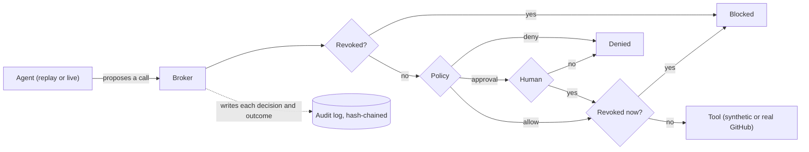

# Architecture

Warden sits between an AI agent and the tools that change access. The agent proposes what it wants to
do, and Warden controls whether it actually runs. This note walks through the pieces and why they are
shaped the way they are.

## The core idea

The agent never holds a tool. It proposes a call and hands it to the broker. The broker is the only
code that touches a tool, and it runs the same path for every proposed action, whether the action came
from a recorded run or a live model.

The second revocation check, after the approval, is the subtle part: a revoke that lands while a step
waits for a human still stops it.

## Pieces

**domain** holds the models, enums, and event types. Every other module imports it; it imports none of
them. The audit event carries a schema version, a sequence number, the previous hash, and its own hash
over a canonical serialization, so the log can be verified later.

**policy** is a deterministic, first-match engine over an ordered ruleset with a default deny. It never
calls out to anything, so the same action and ruleset always give the same answer. That is what lets
the audit log name the exact ruleset version behind every decision.

**audit** is an append-only, hash-chained log. Each entry's hash covers its content and the previous
hash, so any edit, insertion, or deletion that does not rewrite the whole downstream chain is caught by
verify. Secrets and personal data are masked before anything is written.

**revocation** models a gap that shows up in systems that validate tokens offline. It has an authority
that records revocations, two enforcement points that honor them at different speeds, a receiver
modeled on CAEP and the Shared Signals Framework that closes the gap, and a measurement that times how
long an agent keeps working after it is revoked.

**tools** are the access-ops tools over synthetic company data: a directory, a VPN, and a source
control system. The broker reads each operation's risk from the tool's own spec, so the agent cannot
relabel a high-risk call as a low one.

**gateway** is the broker. It resolves the real risk and the target account's tier, builds the action,
checks revocation, evaluates policy, waits for a human when required, re-checks revocation right before
running, executes under a per-session lock, and writes the audit entry.

**agent** has three parts: a replay agent that yields a fixed trajectory so the demo runs with no key,
a live adapter that drives a real model through the Messages API tool loop, and a runner that drives
either one through the broker until it finishes, is revoked, or hits a step limit.

**eval** runs governance scenarios and the revocation benchmark and folds the results into one report.

**api** is a FastAPI app. It starts a run, streams events over Server-Sent Events, accepts an approval,
and accepts a revoke. It holds no policy logic of its own. It builds a control plane through the same
factory the tests and the CLI use.

## Why the re-check after approval

A high-risk step waits for a human. While it waits, an operator might revoke the agent. If the human
then approves the step, it must not run, because the agent was revoked in the meantime. The broker
handles this by checking revocation again, under the session lock, right before it executes. The test
suite covers this case directly. Without that re-check, the kill switch would miss exactly this case.

The guarantee is precise: no action *starts* after a revoke. Once an action passes that final check
under the lock, the broker emits a commit marker and runs the tool, and a revoke that lands during an
in-flight call to a real external system cannot recall it. That is a property of external side
effects, not a gap in the control: the audit records the revoke and the completion, the event stream
carries the commit marker, and the reliability invariant keys off that commit, so a slow call
finishing after a concurrent revoke is never mistaken for a new action started after it. The kill
switch's job is to stop the next thing, and everything not yet committed is blocked at once.

## Why two enforcement points

Revoking is instant. How quickly each enforcement point acts on it is what varies. A gateway that
checks the authority live stops at once. An offline validator that trusts a cached grant, the way a
cached JWT check does, keeps saying yes until the grant expires. Warden models both so the gap can be
measured, and models the CAEP-style signal that closes it. This mirrors how revocation actually lags in
systems that validate tokens offline.

## State and boundaries

State is in memory and scoped to one process. The audit log, the sessions, and the tool data would all
move to durable storage in a real deployment, and the audit head would be anchored outside the log so a
full-chain rewrite could be detected. These boundaries are deliberate: they keep the governance path
small enough to read and test by itself.
