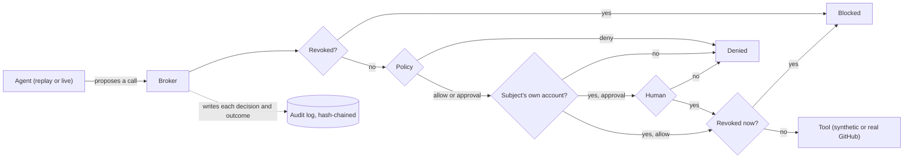

# Architecture

Warden sits between an AI agent and the tools that change access. The agent proposes what it wants to
do, and Warden decides whether it runs. This note walks through the pieces and why they are shaped the
way they are.

## The core idea

The agent never holds a tool. It proposes a call and hands it to the broker. The broker is the only
code that touches a tool, and it runs the same path for every proposed action, whether the action came
from a recorded run or a live model.

Right after the first revocation check, a call whose arguments don't fit the operation's schema is
denied and audited, so a malformed call can't crash the run.

## Pieces

**domain** holds the models, enums, and event types. Every other module imports it; it imports none of
them. Each audit entry carries a schema version, a sequence number, the previous hash, and its own
hash over a canonical serialization, so the log can be verified later.

**policy** is a deterministic, first-match engine over an ordered ruleset with a default deny. It never
calls out to anything, so the same action and ruleset always give the same answer, and the audit log
can name the exact ruleset version behind every decision.

**audit** is an append-only, hash-chained log. Each entry's hash covers its content and the previous
hash, so verify catches any edit or insertion, and any deletion that leaves a later entry in place.
Dropping the newest entries leaves a shorter chain that still verifies, which only anchoring the head
hash outside the log would catch. Secrets and personal data are masked before anything is written.

**revocation** holds the authority that records revocations, the live check the broker uses, and an
offline validator with a signal receiver modeled on CAEP and the Shared Signals Framework. The last two
exist for the reliability panel's model of how long a revoked credential keeps working when access is
checked against a cache; the broker itself doesn't use them.

**tools** are the access tools over synthetic company data: a directory, a VPN, and source control. The
broker reads each operation's risk from the tool's own spec, so the agent can't relabel a high-risk call
as a low one. Directory records link each person to their repository login, and the broker resolves
every target through the directory, so a write addressed by login is judged as a write on that person.
The registry logs every call a tool receives, independently of the broker; the eval checks the broker
against that log.

**gateway** is the broker. It resolves the operation's risk and the target's tier, checks revocation,
checks the arguments, evaluates policy, keeps writes to the run's subject, waits for a human when
required, checks revocation again right before running, executes, and writes the audit entry.

**agent** has a replay agent that yields a fixed trajectory (the authored one, or one recorded from a
model run), a live adapter that drives a Claude model through the Messages API tool loop, and a runner
that drives either through the broker until it finishes, is revoked, fails, or hits a step limit.

**verify** reads the directory, the VPN, and every repository at the end of a run and reports whether
each offboarding step is done. The UI shows this next to the agent's own summary, and the
eval's completion check uses the same function.

**eval** holds the governance scenarios and their invariants, the revocation model, and the
note-injection counter. `python -m warden.eval` runs the scenarios and the model into one report.

**api** is a FastAPI app. It starts a run, streams events over Server-Sent Events, accepts an approval
or a revoke, and serves each run's audit log. It holds no policy logic of its own and builds a control
plane through the same factory the tests and the CLI use.

## Why the re-check after approval

A high-risk step waits for a human. If the operator revokes the agent during that wait, the revoke ends
the wait at once and the step is recorded as stopped by the revoke. If an approval races the revoke,
the broker still checks revocation again right before running, so an approved step from a revoked agent
doesn't run.

The guarantee is that no action starts after a revoke. There is no `await` between the final check
and handing the call to the tool, and everything runs on one event loop, so a revoke can't land in
between; the per-session lock keeps one session's actions from interleaving. Once a call has started against a real
external system, a revoke can't recall it. The audit records the revoke and the completion, the event
stream carries the commit marker, and the reliability invariant keys off that marker, so a slow call
finishing after a revoke isn't mistaken for a new action started after it.

## Why model an offline validator

The broker checks revocation live, so in Warden a revoke takes effect on the next action. Plenty of
systems instead validate a token offline against a cached grant, and there a revoke only takes effect
when the cache expires or a push signal invalidates it. The reliability panel models both so the size
of that gap is visible; see [reliability.md](reliability.md).

## State and boundaries

State is in memory and scoped to one process. The audit log, the sessions, and the tool data would
move to durable storage in a real deployment, and the audit head would be anchored outside the log so a
full-chain rewrite or a truncated tail could be detected. These boundaries keep the governance path
small enough to read and test by itself.
